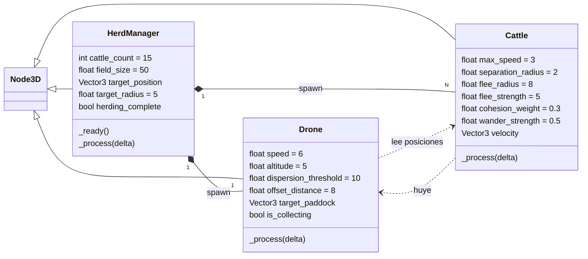
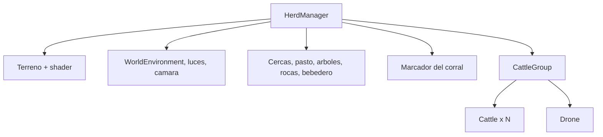
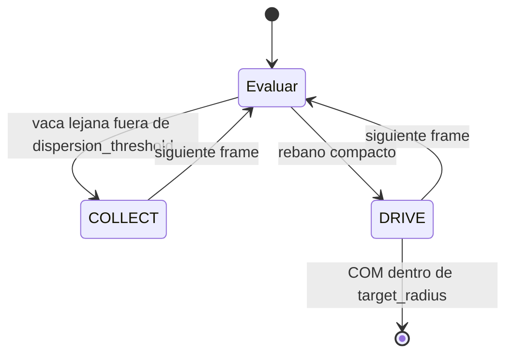
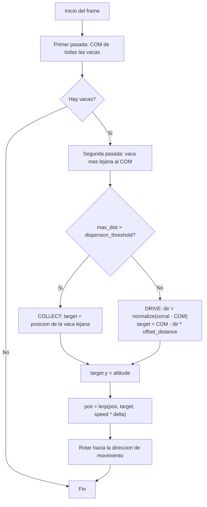
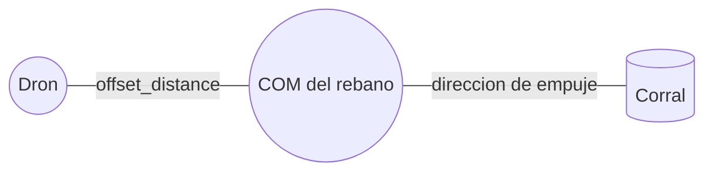
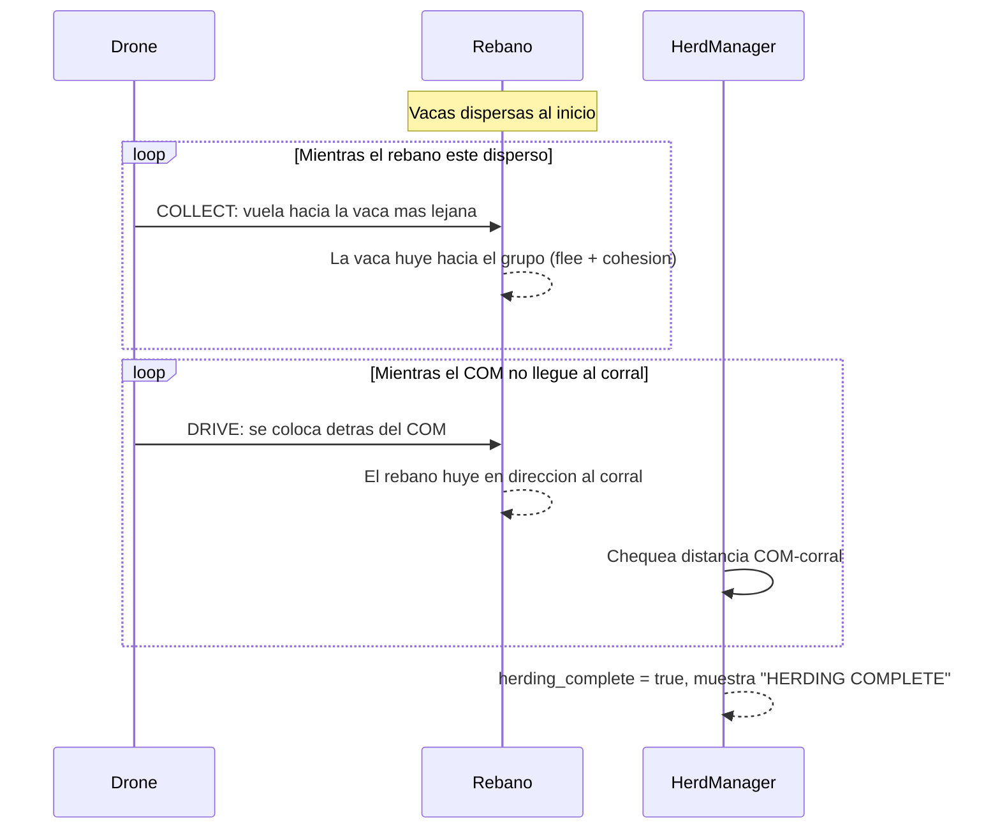
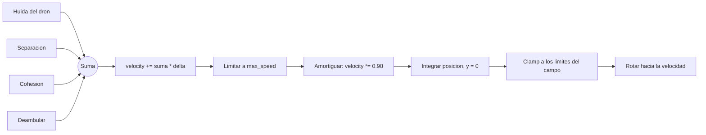
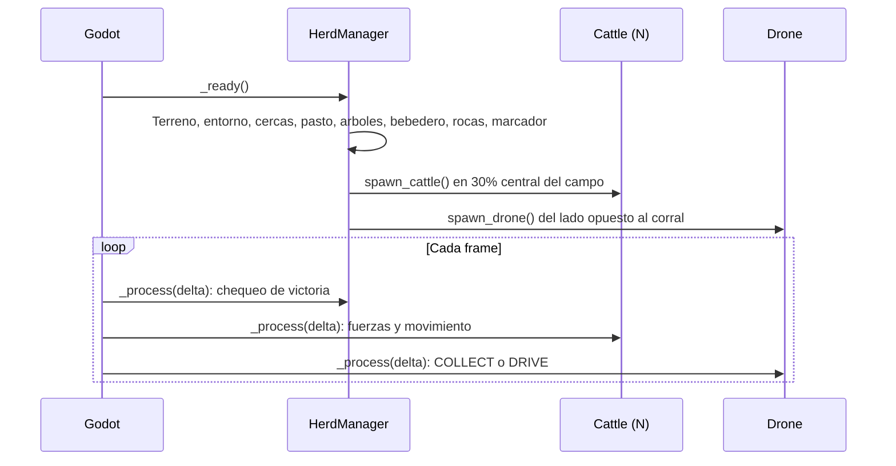

# GrazeMate Sim

Simulacion 3D de arreo de ganado con drones, construida como GDExtension en C++ para Godot 4.6. Un dron autonomo agrupa a las vacas dispersas y luego las conduce hasta un corral objetivo, usando una version simplificada del algoritmo de pastoreo de Strombom.

## Contenido

- [Estructura](#estructura)
- [Compilacion](#compilacion)
- [Arquitectura](#arquitectura)
- [Como arrea el dron](#como-arrea-el-dron)
- [Comportamiento de las vacas](#comportamiento-de-las-vacas)
- [Ciclo de simulacion](#ciclo-de-simulacion)
- [Parametros](#parametros)
- [Limitaciones y proximos pasos](#limitaciones-y-proximos-pasos)

## Estructura

```
.
├── CMakeLists.txt        # Build de la extension (usa godot-cpp como subdirectorio)
├── project/              # Proyecto Godot
│   └── project.godot
└── src/
    ├── herd_manager.*    # Escena: terreno, entorno, spawn y condicion de victoria
    ├── drone.*           # Logica de arreo (collect / drive)
    ├── cattle.*          # Comportamiento de rebano (boids + huida)
    └── register_types.*  # Registro de clases en Godot
```

## Compilacion

Requisitos: CMake 3.17+, compilador C++17, Godot 4.6.

```sh
git clone -b 4.x https://github.com/godotengine/godot-cpp
cmake -S . -B build
cmake --build build
```

Las librerias se generan en `project/bin/` para los targets `template_debug`, `template_release` y `editor`.

Para cargar la extension, el proyecto necesita un `project/grazemate.gdextension` (no versionado todavia):

```ini
[configuration]
entry_symbol = "grazemate_library_init"
compatibility_minimum = "4.6"

[libraries]
macos.debug = "res://bin/libgrazemate.macos.template_debug.framework"
macos.release = "res://bin/libgrazemate.macos.template_release.framework"
linux.debug.x86_64 = "res://bin/libgrazemate.linux.template_debug.x86_64.so"
linux.release.x86_64 = "res://bin/libgrazemate.linux.template_release.x86_64.so"
```

Y una escena `res://scenes/main.tscn` cuyo nodo raiz sea un `HerdManager`. Opcionalmente se pueden agregar `res://models/cow.glb` y `res://models/drone.glb`; si no existen se usan modelos CSG de respaldo.

## Arquitectura



Arbol de nodos en tiempo de ejecucion. El dron y las vacas son hermanos dentro de `CattleGroup`, asi cada uno encuentra al otro recorriendo los hijos del padre:



## Como arrea el dron

El dron mira al rebano completo en cada frame y elige entre dos modos segun cuan disperso este:

- **COLLECT**: si la vaca mas alejada del centro de masa (COM) esta a mas de `dispersion_threshold`, el dron vuela hacia ella. Al acercarse, la vaca huye en direccion opuesta, es decir, hacia el grupo.
- **DRIVE**: si el rebano esta compacto, el dron se ubica detras del COM, del lado opuesto al corral, a `offset_distance`. Las vacas huyen hacia adelante y el rebano avanza hacia el corral.



Decision por frame (`Drone::_process`):



Geometria del modo DRIVE. El dron, el COM y el corral quedan alineados:



Interaccion entre ambos lados durante un ciclo completo de arreo:



## Comportamiento de las vacas

Cada vaca es un agente tipo boid en el plano XZ. En cada frame suma cuatro fuerzas:

| Fuerza | Condicion | Calculo |
|---|---|---|
| Huida (flee) | dron a menos de `flee_radius` | `normalize(yo - dron) * flee_strength` |
| Separacion | otra vaca a menos de `separation_radius` | suma de `normalize(yo - otra) / dist` |
| Cohesion | siempre | `(COM_otras - yo) * cohesion_weight` |
| Deambular | siempre | ruido aleatorio `* wander_strength` |



La huida es lo que permite el arreo: el dron nunca empuja directamente, solo se posiciona para que la reaccion de escape de las vacas apunte hacia donde se quiere llevarlas.

## Ciclo de simulacion



## Parametros

Expuestos en el inspector de Godot:

| Clase | Propiedad | Default |
|---|---|---|
| HerdManager | `cattle_count` | 15 |
| HerdManager | `field_size` | 50 |
| HerdManager | `target_position` | (20, 0, 20) |
| Drone | `speed` | 6 |
| Drone | `altitude` | 5 |
| Drone | `target_paddock` | asignado por HerdManager |
| Cattle | `max_speed` | 3 |
| Cattle | `separation_radius` | 2 |
| Cattle | `flee_radius` | 8 |

Internos (solo en codigo): `dispersion_threshold = 10`, `offset_distance = 8`, `flee_strength = 5`, `cohesion_weight = 0.3`, `wander_strength = 0.5`, `target_radius = 5`.

Relaciones a tener en cuenta al ajustar:

- `offset_distance` debe ser menor que `flee_radius`, o en modo DRIVE el dron queda fuera del alcance y las vacas no avanzan.
- La huida usa distancia horizontal, por lo que `altitude` no afecta la reaccion del ganado.
- El movimiento del dron es un `lerp` exponencial: `speed` controla que tan rapido converge, no una velocidad lineal.

## Limitaciones y proximos pasos

- En COLLECT el dron va directo a la vaca lejana; Strombom original se ubica detras de ella (del lado opuesto al COM) para empujarla hacia el grupo.
- Un solo dron. Escalar a varios requiere repartir el rebano o los sectores entre drones.
- Busqueda de vecinos O(N^2) y por `get_class()`; suficiente para decenas de vacas.
- Faltan versionar `main.tscn`, el archivo `.gdextension` y fijar `godot-cpp` como submodulo.
